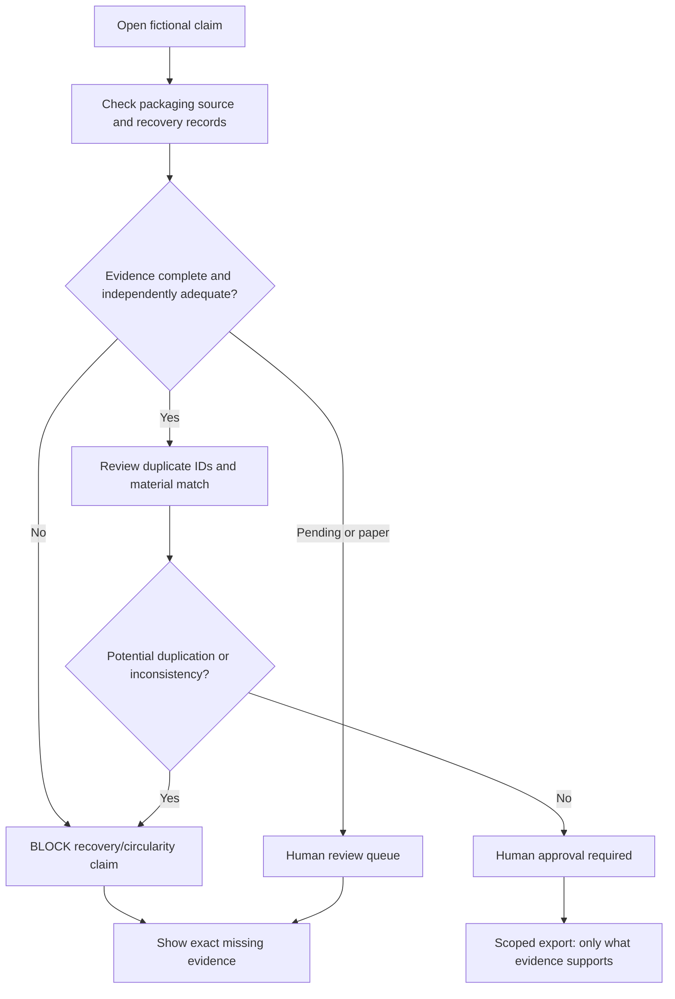
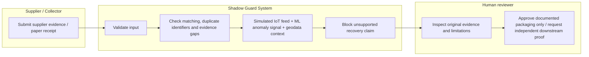

# WEEK 11 — PACKET BEFORE CODE

**Project:** EPR Shadow Guard  
**Builder:** Sofia Lopez — ADVERSARY, Team 8  
**Chapter:** Dreaming of Plenitude  
**Blueprint:** EPR-COMPLIANCE — Packaging Evidence Diagnostic  
**Primary design condition:** #6 SHADOW CLAUSE — Prevent compliance theater and worker exclusion

## 1. Problem in my words
Packaging evidence is not the same as proof that discarded material was actually recycled. A producer could upload incomplete or repeated recovery records and make an environmental claim that sounds stronger than the evidence. Conversely, an informal collector with a legitimate paper receipt could be excluded merely because the record is not digital. I am testing whether a small evidence-review guard can prevent those two failures *without pretending to certify recycling*.

## 2. Exact user
A fictional evidence reviewer at a small Mexican packaging producer who must decide which packaging and recovery claims can be exported, which need supporting documents, and which cannot be stated. Secondary affected person: an informal collector whose paper receipt must be eligible for human review without profiling or identifying them.

## 3. Success definition — before this module closes
A public demo URL allows a reviewer to inspect fictional packaging and recovery records, see labels distinguishing documented packaging from independently substantiated downstream recovery, flag missing or potentially duplicate recovery claims, route a nondigital paper receipt to human review, reject unsupported circularity claims, and inspect a simulated sensor+ML+geodata diagnostic. No simulated or missing evidence may silently become verified. A reviewer can see why an export claim is blocked. The app must visibly state that it is a classroom demo and not compliance certification.

## 4. Visual mockup
See `assets/mockup.svg` — a visual wireframe of the proposed evidence desk. **Mockup generation requirement:** the professor requests an *image-generated* mockup. A separate generated image from an image model must be inserted or linked here before submission; the SVG is an implementation wireframe, not a substitute for documenting actual image generation.

## 5. Feature flow (Mermaid)

## 6. Multi-actor swimlane (Mermaid)

## 7. Global benchmark line
**Existing benchmark:** Specright (specification and packaging-data management) and Recyda (packaging and EPR data workflows) show that packaging-evidence systems already exist. **My local difference/hypothesis:** this narrow Mexican classroom prototype explicitly demonstrates the failure boundary between packaging readiness and recycling assertions, including nondigital collector receipts and worker-data safeguards; it does not claim unique market differentiation until an incumbent comparison is tested.

## 8. Long view — three sentences
If the slice worked in a controlled test, it could become an evidence-integrity layer integrated into established EPR reconciliation tools rather than another proprietary compliance platform. Over three years, a real system would need validated Mexican legal requirements, independent recovery-evidence partners, auditable human reviewers, and protection against supplier/collector exclusion. Expansion would stop if it cannot distinguish verified recovery from documents or protect worker-linked information.

## 9. Scope cuts
**KEEP:** fictional claim review, missing documents, material mismatch, possible duplicate IDs, human-review status for paper receipts, blocked unsupported claims, evidence provenance, simulated sensor feed, small ML anomaly indicator, geodata context, audit notes. **DEFER:** real users, supplier onboarding, real sensor integrations, official EPR submissions, legal rule engine, database with personal information, government integration. **KILL:** automatic recycling certification, environmental credits, worker scoring, identifiable collector profiles, real payment/settlement, unsupported additionality claims, recycling-tips/awareness campaign.

## 10. Architecture and Dragon Stack
| Layer | Free implementation | Purpose and limitation |
| --- | --- | --- |
| UI | Static HTML/CSS/JavaScript | No account/login or personal records; browser-only fictional example |
| IoT / sensing | Clearly labeled **simulated scale-feed samples** | Displays recorded weights, **not** physical proof of recycled material |
| ML | Lightweight local k-nearest-neighbor anomaly detector trained on **fictional weight-pattern examples** | Advisory anomaly signal, never factual verification or automatic approval |
| Third tech — geodata | Haversine distance across **fictional facility locations** | Context for route plausibility, not proof of origin or chain of custody |
| Rules | Deterministic claim/evidence checks | Block unsupported wording and possible duplicated recovery record IDs |
| Human oversight | Mock review queue | Pending records remain pending; no fictional approval masquerades as real |
| Storage | None | No personal data, API keys, or persistent database |
| Hosting | Vercel static site | Free stack, public URL when actually deployed |

## 11. Security floor
1. No API secrets or credentials in source or repository. 2. No personal data stored, so auth is not applicable to this classroom demo; if real data were added, authentication would be required. 3. No Supabase database or user tables, so RLS is not applicable; any future personal-data table must enable RLS. 4. Input is tightly validated and rendered with safe text content. 5. All examples are invented and identified as fictional on screen. Never process actual collector data in this demo.

## 12. Test plan
- T01: Packaging documentation alone cannot produce a verified-recycling claim.
- T02: Missing downstream evidence blocks recovery claim with clear reason.
- T03: Reusing a recovery-record ID is flagged as potential double counting.
- T04: A paper receipt is routed to human review, not rejected automatically or marked verified.
- T05: A mismatch between claimed and documented material is flagged.
- T06: Sensor feed is labeled simulated; its values cannot prove recycling.
- T07: ML indicator is labeled advisory and fictional, never controls verification.
- T08: Geodata sample is labeled fictional, never proofs origin.
- T09: Unsafe/empty or excessively long inputs are rejected without crashing.
- T10: All human review states stay pending in the demo; no worker profiles or identifiers.
- T11: Source provenance and limitation displayed for every case.
- T12: Run automated tests and manually find/fix at least one *real* bug; record original behavior, fix and redeploy.

## 13. Evidence and validation placeholders (to complete only when actually done)
- Packet-created date/time: [fill after real commit]
- First deployment URL: [pending]
- Second deployment URL: [pending]
- GitHub repository: [pending]
- Mechanical test bug + commit SHA: [pending]
- Fresh-chat persona prompt, actual screenshots, response transcript: [pending]
- Worst confusion and ONE actual fix: [pending]
- Three-minute live demo + 30-second reflection: [pending]
